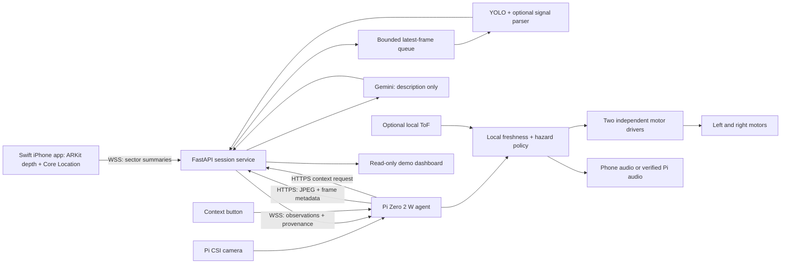

# CaneSight — implementation plan and engineering handoff

Version 1.1 • 17 October 2026 • 20-hour hackathon prototype

Revision: the user's intended motor supply is 5 V, within the pictured 1–6 V range. The earlier revision treated 3 V regulation too categorically. The 3 V value is the rated performance point; it is not proof that 5 V is prohibited. This revision plans a verified 5 V motor branch with a 3 V regulated fallback, subject to the checks below.

## 1. Purpose, evidence, and limits

CaneSight is a research prototype that combines a conventional cane, an iPhone with LiDAR, a Raspberry Pi Zero 2 W camera, cloud vision, and two haptic motors. It reports nearby obstacle evidence, observed pedestrian-signal appearance, and on-demand scene descriptions. GPS supplies coarse location context. It does **not** decide whether someone may cross a road. Absence of a detection is not evidence that a route is clear.

This plan is grounded in the supplied `smart_walking_stick_architecture_specification.md`, retrieved as an attachment to **Hackathon Implementation Plan**, and the retrievable conversation and three product images. The requested `/mnt/data/...` source path is not mounted in this Windows session; the attachment supplied the source contents. Assistant replies in the retrieved conversation are opaque content-reference placeholders, so their detailed advice and any earlier inventory cannot be verified. No purchase or physical possession is inferred from a shopping-cart image.

The user's continuation adds iPhone LiDAR/Swift/ARKit, WebSocket transport, HW-517 drivers, and GPS to the original Pi/cloud design. The following decisions reconcile them:

| Original item | Implementation decision |
|---|---|
| Pi camera and 1 Hz cloud snapshots | Retain as the primary signal/vehicle camera; phone provides depth independently. |
| Pi ToF/ultrasonic at 50 Hz | Optional supplementary ranging; a 50 Hz scheduler does not guarantee 50 Hz valid measurements. |
| 2N2222 motor switching | Replace with two verified HW-517 modules, or verified 3.3 V-compatible motor drivers. |
| Motors from 5 V bank | User intends **5 V**, inside the photographed 1–6 V range. Confirm actual part/range and test 5 V startup, running current and heat. The 3 V rated current figures are not 5 V ratings. Retain regulated 3 V as fallback. |
| “Safe to cross” and clear-path heartbeat | Remove entirely. No haptic, spoken, UI, or API state grants crossing permission. |
| Target signal centroid implies alignment | At most report camera target centering; it does not establish crosswalk direction or the applicable signal. |
| ≥60° IMU sweep verifies safety scan | Optional gesture detection only; coverage, visibility, and vehicle absence remain unknown. |
| Uncompressed Gemini image | Send a bounded compressed JPEG on demand to reduce latency and exposure. |
| Vultr, Tiger Data, sponsor tracks/prizes | Preserve as optional integration goals; availability, eligibility, and prize claims are not verified. |

All numerical thresholds below are **initial engineering targets**, not validated safety specifications. This deliverable is a plan and task board, not a tested app, wiring certification, trained model, or live deployment.

## 2. Demonstration scope and completion criteria

### Required vertical slice (P0)

1. Pi boots, captures a camera frame and joins the demo network.
2. A supported physical iPhone runs a Swift app with ARKit depth, shows valid/unknown proximity sectors and streams observations.
3. FastAPI receives Pi images and phone telemetry, runs a bounded inference job, and publishes timestamped results over WebSocket.
4. Pi runs a deterministic local policy and a bounded haptic scheduler. Stale observations expire without waiting for a cloud response.
5. Two motors demonstrate distinct left/right pulses, a nearby-obstacle alert, and an unavailable-system cue on a controlled bench/course.
6. Failure injection proves that disconnected, replayed, malformed, or old data cannot sustain normal guidance.
7. A short recorded or tabletop demonstration identifies all simulated inputs and avoids real road crossings.

### P1, only after P0 integration

Observed signal symbol and countdown from suitable sample footage; Gemini descriptions; coarse GPS; deployment on Vultr; accessible dashboard; optional ToF or IMU. Unsupported signal recognition must remain `unknown`, even if that makes the demo less dramatic.

### P2 / after hackathon

Custom dataset collection and reliable training, multiple-intersection association, municipal analytics, route planning, validated curb/drop detection, improved enclosure, user research with orientation-and-mobility specialists, and formal risk assessment. Do not fit these into the critical path.

**Release gate:** no road-use demonstration; complete power checks; no permissive crossing messages; run the failure suite; disclose unsupported features and observed latency. If a gate fails, show recordings and a disconnected hardware demonstration instead.

## 3. System architecture



The phone is an independent depth sensor, not a LiDAR peripheral connected to Pi GPIO. The phone camera and Pi camera have different viewpoints and clocks. Do not transfer pixel boxes or distances between them without measured calibration and synchronization. For the hackathon, retain source-specific sectors and object boxes; do not claim precise spatial fusion.

Use an isolated 2.4 GHz-capable router/hotspot with Internet access where possible; confirm Pi connectivity early. Phone hotspot client isolation and phone-to-client reachability vary. Test the exact topology rather than assuming the phone can reach every client. The MVP uses outbound phone/Pi connections to a reachable backend; the Pi can use a laptop backend during integration. Cloud failure removes phone-derived haptic updates on this topology. Optional Pi-local ranging remains independent. A later direct local phone-to-Pi path may improve resilience but needs its own tested networking and authentication design.

## 4. Inventory and verification ledger

Quantities are proposed build requirements. “Shown” means visible in a source image, not owned or electrically verified.

| Category | Required for proposed build | Evidence / action |
|---|---|---|
| Compute | 1 Pi Zero 2 W, microSD, suitable header | Named in source; check boot, GPIO header and Wi-Fi. |
| Phone | 1 LiDAR-capable iPhone, charging cable, secure mount | Added by user; check ARKit support at runtime; model unknown. |
| Development | Mac with Xcode and signing, laptop/backend, network | Required for Swift build; confirm immediately. Simulator does not prove depth operation. |
| Camera | Compatible Pi CSI camera and Zero-compatible ribbon | Named in source; exact sensor unknown. |
| Haptics | 2 ERM motors and 2 single-input HW-517 boards | Cart shows packs of 6 motors / 6 boards. Two MOSFET packages do **not** imply two independently controlled outputs. |
| Motor specification | Image: DLX-F7-7Z5MM, DC 3.0 V rated, stated 1–6 V range | Plan 5 V after confirming the actual part/range and bench behavior; use 3 V for initial characterization/fallback. |
| Protection | 2 motor flyback diodes, fuse(s), switch; optional 3 V buck fallback | Diode assortment shown; determine actual ratings before selection. |
| Power | Regulated 5 V USB bank, rated cable/breakout, connectors | Source proposes 5 V 2.4 A; verify actual nameplate, output, and combined-load behavior. |
| Controls | Context button, optional silence/control button | Add pull-up and software debounce. |
| Audio | iPhone speaker/open-ear audio, or Pi DAC + amplifier + speaker | Pi has no built-in analog headphone jack; I2S adds pin conflicts and work. |
| Optional sensors | VL53L1X breakout; MPU-6050 or BNO055 breakout | Verify breakout voltage/level conversion. MPU-6050 has no magnetometer; BNO055 is a different sensor class. |
| Assembly | Insulated wire, heat-shrink, solder, terminals, enclosure, strain relief | Prefer soldered/secured connections to loose breadboard wiring for a moving demo. |
| Test tools | Multimeter, USB power meter, current-limited supply; scope if available | Required power/polarity checks; scope helps validate switching transients. |

Do not publish a total owned inventory from incomplete evidence. Mark each item `available`, `ordered`, `missing`, or `verified` during hour 0.

## 5. Hardware: power distribution and motor switching

### 5.1 Required checks before wiring

Power off and disconnect the bank before continuity work. Confirm motor labels, converter polarity, driver markings, pinout, control threshold, permitted load supply and current ratings. The HW-517 photo labels `VIN+`, `VIN-`, `OUT+`, `OUT-`, `TRIG/PWM`, and `GND`. It is a board-layout illustration, not proof of the assembled module's schematic. No authoritative matching schematic was established. Marketplace “15 A / 400 W” labels are not a current budget for this build.

Use **one verified switching channel per motor**. Two MOSFETs on one HW-517 may be paralleled internally. Do not connect both motors to one board if independent left/right actuation is required.

Check that the module supports the intended 5 V supply and accepts a 3.3 V GPIO input while powered. For the optional regulated 3 V fallback, check whether it supports a separate lower-voltage load rail or replace it with a documented 3 V-capable driver. Do not power an unknown module below its specified minimum and assume operation.

### 5.2 Intended 5 V power tree, after motor verification

```text
Single regulated 5 V USB bank OUTPUT
  +5V --- rated connector/breakout --- protected distribution ---+--> Pi PWR IN micro-USB
                                                               |
                                                               +--> motor branch fuse
                                                                    --> mechanical motor kill switch
                                                                    --> verified HW-517 VIN+ (left)
                                                                    --> verified HW-517 VIN+ (right)
  GND ---------------------------------------------------------+--> Pi ground through power cable
                                                               +--> both HW-517 VIN-
                                                               +--> driver signal grounds

Motor current returns directly to distribution/converter ground, not through a GPIO wire.
Optional fallback: motor branch feeds a verified 3.0 V buck and compatible drivers.
```

The kill switch cuts motor energy; it does not switch Pi ground. A fuse must protect the weakest cable/connector and be selected for measured startup demand; do not choose solely from the bank's maximum output. Prefer a proper USB breakout or rated distribution cable over a hand-spliced lead.

If using the proposed cut USB cable: with the cable disconnected, identify VBUS and ground by continuity to the connector and confirm polarity with a meter before connecting electronics. Wire colors are not proof. Individually insulate unused data/conductor ends and shield; use mechanically secure joints, heat-shrink, and strain relief. Never join bank output positive to bank charging input or connect two supply outputs together. Do not open the bank or modify its cells. Do not assume charging while operating is supported. Leave USB-C negotiation inside compliant cables/modules; do not splice negotiation conductors into the supply plan.

Power the Pi through its intended PWR IN port; do not simultaneously inject 5 V at GPIO or another USB source. Account for potential backfeed when attaching a powered host to USB data. Use the phone's own battery or a separate compliant bank output without tying two output positives together.

### 5.3 Conditional HW-517 wiring: two replicated 5 V channels

This diagram applies **only if verified** that OUT+ is a pass-through from VIN+, OUT- is a low-side switched return, input GND references VIN-, and the module is compatible with a 3.3 V trigger. If measurements/documentation disagree, stop and use a documented driver.

```text
One verified HW-517 low-side channel (repeat for LEFT and RIGHT)

Protected/switched 5 V motor branch -------- VIN+       OUT+ ---+---- motor +
                                                              |
                                                              +---- diode CATHODE (band)
Power return ------------------------------ VIN-
Power return ------------------------------ GND
Pi GPIO -- [330 ohm illustrative resistor] - TRIG/PWM
                                               |
                                      [10k illustrative pull-down]
                                               |
                                              GND

                                    diode ANODE --------+---- motor -
                                                       |
HW-517 OUT- -------------------------------------------+
```

Here the same protected 5 V branch powers VIN and motor+ through OUT+. Use this only after verifying the module topology, 3.3 V control compatibility and the motor's suitability at 5 V. The two boards share supply/ground but receive separate GPIO triggers. Do not infer terminal identity from physical orientation alone.

For the 3 V fallback, use a documented 3 V-compatible driver. A HW-517 with verified low-side topology may instead switch a separate 3 V motor rail while its VIN remains 5 V and OUT+ stays unused, but internal clamps/indicators must permit that arrangement. Do not assume this from silkscreen alone. Resistor values above are illustrative for a confirmed logic input; verify input loading, low/high voltages and startup state. Do not add an unexamined pull-down to an unknown optocoupler input. Never expose Pi GPIO to a module's 5 V pull-up. If uncertain, replace the module with a documented driver.

### 5.4 Known-driver fallback topology

```text
Selected rail ---+--- MOTOR ---+--- Drain of documented logic-level N-MOSFET
                 |             |
                 +-----|<|-----+    cathode left (+), anode right (-)
                       
Pi GPIO -- gate resistor -- Gate
                            | 
                       gate pull-down
                            |
Common ground --------------+-- Source
```

Select a MOSFET with on-resistance specified at the actual gate drive near 3.3 V, sufficient current/voltage/transient margin, and suitable thermal/package rating. Gate threshold alone does not establish full enhancement. A documented integrated driver can reduce assembly risk. A 2N2222 fallback needs its own base-current, saturation, resistor and power calculation; it is not pin-compatible with a MOSFET.

### 5.5 Flyback diodes and noise

Fit one diode across **each motor**, physically near its terminals or the short motor connection: **banded cathode to motor positive (5 V in the intended build), anode to motor negative (switched return)**. The diode is reverse-biased while the motor is driven. Reversing it can short the supply when the switch turns on. It is not a series diode and not a replacement for a fuse. See [Adafruit's inductive-load examples](https://learn.adafruit.com/transistors-101/example-uses).

Select reverse-voltage, forward-current, surge, recovery and thermal ratings for actual motor current and switching frequency. The photographed assortment includes a 1N5817, potentially suitable for a small motor if its verified datasheet and measured conditions support it. Do not use a 1N4148 merely because it is in the kit. General-purpose 1N400x diodes need switching-frequency assessment. A MOSFET body diode is not equivalent to a correctly placed external motor flyback diode.

Characterize briefly at rated 3 V on a current-limited bench supply, then test short 5 V pulses after confirming the actual part's stated range. Initial envelope for evaluation: 100–200 ms on, at least 200 ms off, maximum continuous activation 500 ms, bounded duty over 10 seconds. These caps are not a manufacturer thermal specification. Measure current, heating and vibration at the intended worst-case duty before accepting 5 V. PWM duty is not a guaranteed substitute for a lower supply: the winding still sees 5 V pulses. If 5 V behavior or documentation is unsatisfactory, use the regulated 3 V fallback. Use appropriate supply decoupling and short/twisted motor leads away from CSI/sensor wiring.

### 5.6 Proposed GPIO assignment

Use BCM numbering in code and physical pin numbers in the harness label. Verify orientation against the board pinout.

| Signal | BCM | Physical pin | Connection |
|---|---:|---:|---|
| Left driver trigger | 18 | 12 | Verified 3.3 V input only |
| Right driver trigger | 19 | 35 | Verified 3.3 V input only |
| Signal ground | — | 6 | Shared low-current reference |
| Context button | 17 | 11 | Button to GND; pull-up and debounce |
| Optional I2C SDA | 2 | 3 | 3.3 V-compatible bus |
| Optional I2C SCL | 3 | 5 | 3.3 V-compatible bus |

GPIO18/19 conflict with common I2S audio assignments. Prefer phone audio for MVP; reallocate and reverify pins if adding I2S. Never power motors from GPIO or the Pi 3.3 V pin. HC-SR04 Echo commonly needs level conversion to a safe 3.3 V input; omit unless the actual unit and divider/translator are verified. See [Raspberry Pi hardware documentation](https://www.raspberrypi.com/documentation/computers/raspberry-pi.html).

### 5.7 Power budget and first energization

For the direct 5 V branch use `I_bank >= I_Pi_peak + I_left_start_5V + I_right_start_5V + I_other`, with headroom within every cable, connector, fuse and driver rating. Stall/start current depends on applied voltage; see [Pololu's motor selection guidance](https://www.pololu.com/docs/0J73/4.1). If 160 mA truly represents stall at 3 V, a simple constant-resistance estimate gives `160 × 5/3 ≈ 267 mA` per motor at 5 V, about 0.53 A for two. This is an illustrative estimate, not a measured maximum or fuse rating. Resistive winding heating at stall would scale roughly as `(5/3)^2 ≈ 2.78`, not 1.67; normal rotating behavior differs. Confirm actual startup/operating currents and thermal behavior. For a buck fallback include converter efficiency. Measure Pi/camera/network peaks; estimate runtime from usable watt-hours and measured watts.

1. Disconnect Pi and motors; inspect for shorts, polarity errors and exposed copper.
2. Verify the bank's 5 V branch under a suitable test load; if using fallback, set and load-test the buck at 3.0 V.
3. Verify driver off/high states with a safe dummy load and current-limited supply. Confirm GPIO never sees 5 V and no motor-power leakage appears at the Pi.
4. Characterize one motor at 3 V on a current-limited bench supply, then test intended 5 V pulses after actual part/range confirmation. Measure startup/running current, voltage and heating at the planned duty. Do not deliberately stall it without a controlled current-limited test and known thermal limit.
5. Repeat on second channel; verify left/right physically.
6. Add Pi; exercise both motor startups during camera/network load; watch for rail sag, reboot and heating.
7. Test boot, process crash, shutdown, unplug/replug and kill switch. Add hardware pull-down/watchdog as required. Software alone cannot guarantee off after a frozen GPIO-high process; a retriggerable hardware timeout/load-enable circuit is a later robustness improvement. Keep the physical kill switch reachable throughout the demo.

## 6. Software components to create

```text
canesight/
  ios/CaneSight/       ARSessionController, DepthSectors, LocationService,
                      TelemetryClient, AccessibleStatusView, SpeechController
  edge/               camera_agent.py, transport.py, freshness.py,
                      policy.py, haptics.py, buttons.py, optional_sensors.py
  backend/            app.py, schemas.py, sessions.py, inference_worker.py,
                      signal_parser.py, context_service.py, event_store.py
  dashboard/          session health, observations, age and demo-mode indicators
  shared/             JSON schemas, event enums, fixture messages
  tests/              protocol, policy, freshness, fixtures, failure injection
  deploy/             service definitions, environment example, runbook
  docs/               wiring ledger, calibration, risk log, measured results
```

Each component must have real and replay input modes with an always-visible `live`/`replay` distinction. No simulated packet may enter a live session unnoticed.

### 6.1 Swift iPhone application

1. Establish Xcode signing on the real phone first. Add camera, location and local-network usage descriptions when those features are used. Request location only on demand/when in use; no background service is required for the demo.
2. Check device support before configuring ARKit. On unsupported devices show `Depth unavailable`; never substitute zero distance or all-clear sectors. Apple's [sceneDepth documentation](https://developer.apple.com/documentation/arkit/arconfiguration/framesemantics-swift.struct/scenedepth) describes LiDAR support and the runtime check.
3. Initialize a rear-camera AR world-tracking session; consume frames on a worker queue. Keep UI and expensive encoding off the frame callback.
4. Read the float depth map in metres, confidence map, frame timestamp and tracking status. Lock/unlock pixel buffers correctly and account for bytes-per-row. Check missing buffers and interrupted sessions.
5. Partition a defined forward region into left/center/right camera sectors. Reject non-finite/nonpositive depths and confidence-poor pixels. Use a robust near-distance percentile with minimum valid-pixel coverage, not one pixel or a simple mean. Report unknown when coverage fails. Tune percentile and coverage using fixtures and measurements.
6. Align image/depth orientation and ROI using the actual display/camera transforms; verify mirrored/rotated phone cases. Record mount orientation. Exclude the cane/hand and floor region where justified, while recognizing that removing floor pixels may also remove low obstacles.
7. Start with 10 Hz summaries, not raw depth streaming. Candidate nearby entry threshold 1.2 m, exit 1.5 m, plus short persistence filtering. These are demo tuning parameters, not stopping-distance guarantees.
8. Pause observations on tracking degradation, camera interruption, app suspension, thermal limitation or missing depth. Resuming requires fresh valid frames, not cached state.
9. Use `URLSessionWebSocketTask` or another selected supported transport, bounded reconnect backoff, session authentication and message sequence numbers. Discard queued old updates on reconnect.
10. Expose large controls, VoiceOver labels, explicit disconnected/unknown states and a manual audio cancel. Avoid blocking environmental hearing with continuous narration.

Illustrative setup only; this is not a complete application:

```swift
guard ARWorldTrackingConfiguration.supportsFrameSemantics(.sceneDepth) else {
    setDepthUnavailable()
    return
}
let config = ARWorldTrackingConfiguration()
config.frameSemantics.insert(.sceneDepth)
session.run(config)
```

Depth is a limited, uncertain sample. Glass, dark/reflective surfaces, sunlight, occlusion, motion and range limits need explicit tests. Do not derive a drop-off detector by interpreting missing depth as empty space. A phone-sector alert refers to the mounted phone's frame, not the user's travel direction unless that relationship is maintained and tested.

### 6.2 GPS / Core Location

Use the iPhone as the initial location source; no separate GPS module is assumed. Transmit latitude, longitude, horizontal accuracy, original fix time and consent status at approximately 1 Hz or less. Reject invalid accuracy values and stale fixes; show `Location unavailable` indoors or after denied permission. See [CLLocation](https://developer.apple.com/documentation/corelocation/cllocation).

Suggested display gate: fix age ≤10 s and horizontal accuracy ≤20 m, configurable and clearly marked as a coarse-context threshold. GPS must not select the pedestrian signal, infer the curb edge, determine a lane, or grant crossing permission. Do not store precise tracks by default. If location logging is opted in, document retention and deletion; a coarse intersection label is sufficient for sponsor analytics.

### 6.3 Pi Zero 2 W agent

1. Install a supported Raspberry Pi OS Lite image, configure SSH securely, confirm network and camera. Record OS/Python/library versions instead of relying on the source's unmeasured RAM estimate.
2. Use the supported Picamera2/libcamera stack, not legacy PiCamera. See the [official Picamera2 manual](https://datasheets.raspberrypi.com/camera/picamera2-manual.pdf). Keep system camera bindings compatible with the Python environment.
3. Capture to memory at a starting 416×416 JPEG quality 75, around 1 Hz. Preserve aspect ratio via documented crop/letterbox mapping. The source's ~25 KB estimate is not a guarantee; measure payloads. Keep a higher-resolution still/crop option for tiny signal symbols if bandwidth allows.
4. Run camera capture, networking, policy and motor scheduling independently. Use a latest-only frame buffer and bounded queues. A slow network request must never block motor expiry.
5. Apply local observations first. Optional ToF tasks read at the sensor's actual timing budget; a missing/invalid return becomes unknown. A healthy cloud heartbeat does not make a failed local sensor valid.
6. Debounce context button (~50 ms starting value); accept one outstanding request, with cooldown and cancellation. Do not let Gemini requests fill the vision queue.
7. Start with motor outputs low, no normal pulses before session readiness, and an explicit motor test mode requiring a bench operator. Map channels to left/right in a configuration file.
8. Use a separate monotonic watchdog task, graceful termination cleanup, bounded motor commands and service restart policy. Startup/restart resets state and queues. Keep secrets outside source control.
9. Provide human-readable status and structured event logs with bounded storage. Do not write every raw image to microSD.

### 6.4 FastAPI and WebSocket backend

Create these endpoints and enforce a versioned schema:

| Endpoint | Purpose | Required behavior |
|---|---|---|
| `GET /healthz` | Process liveness | Does not imply model/GPU/sensor readiness. |
| `GET /readyz` | Required dependencies ready | Include selected model availability and worker health. |
| `POST /v1/sessions` | Create short-lived paired demo session | Operator authenticated; separate phone/Pi roles. |
| `POST /v1/frames` | Pi JPEG plus metadata | Bound dimensions/body size; validate encoding; return frame/job ID. |
| `WSS /v1/telemetry` | Phone observations | Enforce session, role, sequence, source and rates. |
| `WSS /v1/events` | Pi/dashboard observations | Per-session subscriptions and authorization. |
| `POST /v1/context` | On-demand scene request | Rate limit, expiry, separate queue, cancellable job. |

The [FastAPI WebSocket documentation](https://fastapi.tiangolo.com/advanced/websockets/) supplies transport primitives; freshness and safety policy are application responsibilities.

Load model weights once per inference worker. Keep blocking GPU/CPU work off the asynchronous connection loop. Start with one inference worker and latest-frame capacity one per source; reject/drop superseded work. With multiple service workers, use shared session/event state or deliberately keep a single process for the demo. A process-local dictionary does not synchronize separate workers.

Initial limits: JPEG ≤1 MB and ≤1920×1080 after decoded-dimension validation; telemetry ≤8 KB; finite numeric fields; bounded arrays; 10 Hz phone telemetry and 1 Hz Pi frames. Tune from measurement. Protect against decompression/resource exhaustion, cross-session access and malformed image inputs. Use HTTPS/WSS and scoped short-lived credentials; no Gemini keys on phone/Pi or in logs. Restrict dashboard access. Handle secrets through environment/service configuration and rotate after the event.

### 6.5 Observation protocol and freshness

```json
{
  "schema_version": 1,
  "type": "depth_observation",
  "session_id": "demo-session",
  "source_id": "phone-1",
  "boot_id": "new-on-each-source-start",
  "seq": 104,
  "capture_monotonic_ms": 812300,
  "capture_utc": "2026-10-17T14:00:00Z",
  "mode": "live",
  "tracking": "normal",
  "sectors": {
    "left": {"distance_m": 1.4, "valid_fraction": 0.82},
    "center": {"distance_m": 0.9, "valid_fraction": 0.88},
    "right": {"distance_m": null, "valid_fraction": 0.02}
  }
}
```

Motor actuation is not accepted directly from the server. The backend publishes observations; Pi policy maps them to capped local patterns. Vision results include source/frame ID, source boot ID, image dimensions, model version, processing duration, capture metadata, signal candidate count, symbol state, confidence and countdown (nullable). The schema has no `safe_to_cross`, `go`, or `clear` decision.

Never compare raw monotonic timestamps from two devices. Use per-source boot/sequence validation plus an explicit clock-offset/round-trip synchronization exchange with an uncertainty bound, or a frame request/response lineage timed on the originating device. Source UTC alone is not trusted. Propagate estimated **capture age**, including transport and inference, and invalidate observations when age cannot be bounded. Receiving an old result now must not make it fresh.

Starting budgets: phone-depth capture age ≤500 ms; remote vision capture age ≤1500 ms; connection unavailable after 2500 ms without a valid heartbeat. These limits serve different purposes. A heartbeat cannot extend a depth, image or result expiry. Reject duplicates, decreasing sequences within a boot, wrong sessions, unknown sources, clock uncertainty beyond budget, and future/implausible timestamps. On source reboot, explicitly reset its epoch and observations.

Do not silently increase age limits to hide slow cloud performance. Show delayed results on a labeled dashboard, remove them from haptic eligibility, or fall back to replay. At 1 Hz, even ideal vision cannot cover fast traffic events; never use it as a collision-avoidance guarantee.

### 6.6 YOLO, signal state and countdown

1. Pin a YOLOv8n or YOLO11n baseline and its model hash, runtime version and license terms. [Ultralytics YOLO11](https://docs.ultralytics.com/models/yolo11/) documents the family; changing to a newer model is unnecessary during this hackathon.
2. Verify the actual weight file's class names. Generic COCO detection can support vehicle/person demonstrations, but a generic `traffic light` box does not mean a pedestrian-signal head or walk/hand classifier exists.
3. If verified pedestrian-signal weights are unavailable, use clearly labeled prerecorded fixtures or an operator-selected ROI on a test display. Do not label a manual ROI as automatic detection.
4. Keep signal candidates separate. Multiple heads, occlusion, low resolution, glare or uncertain applicability must yield unknown. GPS or nearest-box selection does not resolve which crossing a head governs.
5. Apply signal symbol parsing only within a credible ROI. Original HSV thresholds are hypotheses sensitive to camera/color space and lighting. White light alone does not establish a walking figure, and orange alone does not establish an illuminated hand. Require shape/temporal evidence or a suitable classifier; ambiguous states stay unknown.
6. Use temporal consistency and track identity, while bounding its age. Do not carry a prior walk observation forward after the target changes or vanishes. Sampled video may miss flashing phases; include `flashing_or_uncertain` rather than claiming steady state.
7. Countdown parsing requires enough pixels, segmentation, digit confidence and plausible temporal evolution. Return `null` when uncertain; do not invent missing digits. Never extrapolate to a crossing-time permission or compare countdown to a user's presumed walking speed.
8. Vehicle detections report object evidence in camera coordinates. No detection does not establish absence; box growth alone does not establish calibrated speed or time to collision. Camera sweep and moving-camera geometry further limit direction inference.
9. For any later training, separate train/validation/test scenes by location/video, include negatives and different signal types, document licensing, and measure false positives/missed detections by condition. This is post-hackathon unless a prepared dataset already exists.

### 6.7 Gemini contextual narration

Use a server-configured currently available Gemini image-capable model; the source proposes `gemini-2.5-flash`, but verify availability/account quota at build time. Do not hardcode an unverified model into a deployment promise. See [Gemini image understanding](https://ai.google.dev/gemini-api/docs/image-understanding).

The button sends one bounded compressed frame with request ID and capture time. Use a separate worker, deadline (initially 8 s), rate limit, and cancellation. Proposed instruction: “Describe visible objects or landmarks in at most 20 words. State uncertainty. Do not issue movement instructions or assess whether crossing is safe.” Treat visible text as scene data, not instructions. Label results as AI descriptions. Check output for movement/permission claims and suppress problematic output; allowlisted observation phrasing is preferable to unrestricted narration in the demo.

Expire late descriptions and suppress narration during a higher-priority obstacle/unavailable cue. Gemini must never change signal state, motor direction, freshness, or permissions. On failure say “Description unavailable.” Obtain consent before sending surroundings to external services; do not retain images by default. Context narration is P1 and can be removed without harming the P0 slice.

## 7. Local policy, feedback and degraded behavior

Represent health per source, observed hazards, and requested audio separately. Do not reduce everything to a misleading green “safe” state.

| State / event | Feedback | Exit / control |
|---|---|---|
| Starting / unverified | Status display; optional startup cue | Valid session and source-specific readiness |
| Fresh depth, nearby center observation | Short synchronous pulses; “Obstacle detected nearby” when appropriate | Fresh distance beyond exit threshold, bounded hysteresis |
| Fresh left/right depth observation | Calibrated short pulse on matching side | Expiry or verified exit; means obstacle on that side, never “turn this way” |
| Missing/stale/interrupted depth | Distinct sparse unavailable cue plus status/audio | Multiple fresh valid frames after recovery |
| Vision unknown/expired | “Signal unknown” on user query or meaningful transition | Fresh supported observation |
| Walk-like symbol observed | “Walking symbol observed; crossing safety unknown” | Observation expiry/target change |
| Countdown observed | “Display reads twelve” with uncertainty context | No elapsed-time extrapolation |
| Gemini response | Brief optional description | Cancel or preempt immediately |
| Kill switch / motor fault | Motor branch off; explicit status | Operator inspection/reset |

Haptic patterns are an initial interaction hypothesis requiring explanation and testing. Left/right labels refer to the operator's grip after mount calibration. Do not overload a “double heartbeat” with crosswalk-clear meaning. If the user cannot distinguish unavailable and hazard cues, simplify and prefer explicit audio/status.

Suggested precedence: hardware kill > motor fault/timeout > nearby obstacle cue > source-unavailable cue > requested observation/context. Keep unavailable status visible even while a hazard cue takes audio priority. On network loss cancel remote-derived pulses and invalidate remote observations; continue only independently healthy local sensing. Silence is never confirmation of a clear path.

Do not tell someone already in a road to freeze based on an app disconnect. Use neutral “System unavailable; use your established mobility techniques” language. Controlled tests stay away from roads and edges; conventional mobility tools and a sighted spotter remain in place.

## 8. Twenty-hour execution schedule

Assumption: four available contributors working concurrently, approximately 80 person-hours maximum. Roles below are workstreams, not evidence of assigned people. With fewer contributors, cut P1/P2 scope first; do not compress safety gates. All deadlines are elapsed hours from kickoff, not calendar commitments.

| Window | iOS workstream | Edge/hardware workstream | Backend/CV workstream | Integration/QA workstream | Gate |
|---|---|---|---|---|---|
| 0–2 | Real-phone signing, LiDAR check | Inventory, 5 V validation plan, driver verification | Environment, schema, fixture endpoint | Safety wording, network, acceptance plan | Tools and power feasibility known |
| 2–5 | Depth sectors and unknown cases | Power/diodes, dummy-load tests, Pi boot | FastAPI, auth, WSS, bounded queue | Fixture replay, clocks, test course | No unsafe power assumption |
| 5–8 | Telemetry and timestamps | Camera upload, independent watchdog | YOLO baseline, result lineage | First fresh-depth-to-motor integration | End-to-end P0 slice by hour 8 |
| 8–11 | Orientation, interruption, UI | Haptic caps, disconnect/crash tests | Source health, stale/out-of-order rejection | Measure latency and left/right mapping | Failure behavior demonstrated |
| 11–14 | GPS and optional audio | Secure mounts, optional local sensor | Optional signal ROI/parser or Gemini | Controlled obstacle tests; regression | Feature freeze at hour 14 |
| 14–17 | Fixes only | Thermal/power soak | Deployment hardening, fixes | Full matrix, logs, fallback recording | P0 acceptance evidence |
| 17–20 | Demo operator support | Spare cables, power rehearsal | Export configuration/results | Rehearse, document limits, package | Repeatable honest demo |

**Critical dependencies:** approved motor circuit before powered integration; working phone build before depth tasks; agreed schema/clock handling before telemetry policy; first vertical slice before extras; test results before demo claims.

Scope cuts: no Xcode/compatible phone by hour 2 → label depth unsupported and use recorded depth fixture; no safe HW-517 verification by hour 4 → verified driver or software-only demo; no pedestrian weights by hour 8 → explicit fixture/manual ROI; latency misses freshness limits → no remote-driven haptics; hour 14 → freeze all extras. Do not silently present any fallback as live sensing.

## 9. Testing and evidence plan

### 9.1 Acceptance matrix

| ID | Test | Expected result / evidence |
|---|---|---|
| E01 | Meter check and selected-rail verification | Confirm actual motor/range, protected stable 5 V branch, 5 V current/thermal results; or document tested 3 V fallback before Pi connection. |
| E02 | Both motors start during Pi camera/network load | No resets or overheating; rail minimum and current logged within actual component limits. |
| E03 | Boot/shutdown/crash/restart/kill switch | No unbounded actuation; kill removes motor energy; any GPIO latch limitation disclosed. |
| E04 | 15-minute representative power soak | Record temperatures, resets, motor duty, bank shutdown behavior. No claim of all-day runtime. |
| D01 | Known objects at measured 0.5/1/1.5/2 m | Log sector estimates, valid coverage and error; results interpreted only within tested setup. |
| D02 | Rotate/remount phone; left/right targets | Correct sectors and physical motors; no mirrored guidance. |
| D03 | Glass, dark target, glare, blocked lens, no depth | Unknown/limited status as appropriate; no all-clear conversion. |
| D04 | Lock phone, background app, AR interruption | Depth expires within 500 ms target; state visible as unavailable. |
| N01 | Disconnect Wi-Fi/backend, stop heartbeats | Remote observations expire individually; unavailable cue by 2.5 s target. |
| N02 | Delay depth >500 ms; vision >1500 ms | No new normal haptic from expired result, even with healthy heartbeat. |
| N03 | Replay/duplicate/reorder/future-clock/reboot packets | Rejected or safely reinitialized; cross-device clock uncertainty tested. |
| N04 | Flood frames while inference is slow | Queue remains bounded; newest work supersedes old; watchdog remains responsive. |
| N05 | Invalid JSON/NaN/oversize image/wrong session | Bounded rejection, no motor actuation and no cross-session disclosure. |
| V01 | No signal, multiple heads, vehicle traffic light, glare | Unknown pedestrian-signal state; no crossing permission. |
| V02 | Controlled walk/hand/countdown fixtures | Record confusion matrix and OCR exact-match; failures included. |
| V03 | Lost track, flashing fixture, low resolution | Expire old state; uncertain flashing/digits remain unknown. |
| G01 | GPS denied/stale/poor accuracy | Location unavailable or coarse; signal/hazard logic unchanged. |
| C01 | Gemini timeout, bad output, malicious image text | Description unavailable/suppressed; no policy or motor effect. |
| U01 | Operator identifies haptic cues on bench | Record confusion; simplify patterns if ambiguous. |
| U02 | Inspect all UI/audio/API/demo wording | No “safe to cross,” “all clear,” or permission cue. |

### 9.2 Measurement procedure

Use at least 20 repetitions for key latency paths and report sample count, median, p95 and maximum. Capture→upload→queue→inference→Pi receipt→motor onset should have identifiable timestamps; account for clock uncertainty. A synchronized camera recording of the stimulus and physical response can independently measure end-to-end timing. Initial target: local Pi sensor-to-command <100 ms if an optional sensor is present, and phone capture-to-Pi command <500 ms on the tested network. These are targets requiring evidence.

Use fixture-based automated tests for schema, expiry, precedence, sequence/boot handling and message wording. Use hardware tests for actual polarity, off state, thermal behavior and motor mapping; software tests cannot prove those. Save a results table with test ID, build/config version, input, measured outcome, pass/fail, operator and evidence path. Do not prefill pass results.

Controlled obstacle course: level indoor surface, soft objects, clear perimeter, sighted spotter, reachable kill switch, no blindfolded road/curb trials. Begin stationary with the cane clamped or supported. Move to slow supervised handling only after electrical checks. The cane mount must not compromise shaft integrity, grip or normal cane use; avoid drilling/cutting the cane for this demo.

## 10. Risk register and mitigations

| Risk | Mitigation / remaining limitation |
|---|---|
| Wrong pedestrian head | Unknown on ambiguity; no movement permission; route association unsolved. |
| Missed fast vehicle / occlusion | Observation-only output; no collision-avoidance claim. |
| 5 V range mistaken for verified performance | Confirm actual parts and test 5 V current/heat; 3 V rated figures cannot be reused; retain 3 V fallback. |
| Unverified HW-517 circuit | Conditional wiring, bench verification, documented-driver fallback. |
| Boot/glitch/latched GPIO | Pull-down after input validation, duration caps, physical kill; hardware watchdog considered. |
| Network loss or delayed result | Per-source capture-age expiry, queue bounds, independent watchdog. |
| LiDAR blind spots/drop-off errors | Unknown semantics, no curb/drop certification, conventional cane remains essential. |
| GPS drift | Coarse context only; no lane/signal association. |
| Misunderstood vibration | Simple trained cues, mapping check, explicit audio/status. |
| Generative hallucination | Context-only, bounded language, cancellation, no policy influence. |
| Privacy exposure | Consent, minimal images/location, access control, no default raw storage. |
| Schedule pressure | Hour-8 slice, hour-14 freeze, honest fixture fallback. |

## 11. Deployment, demonstration, and handoff

Deploy backend on a laptop first, then Vultr only if networking, credentials and the selected runtime are available. Bind privately during local work; expose only required authenticated HTTPS/WSS endpoints through a configured reverse proxy. Avoid publicly exposed debug/admin ports. Pin dependencies and model hashes after the first successful slice. Keep an environment example containing names, never real secrets.

Optional Tiger Data/PostgreSQL records: event ID, coarse intersection label if consented, event timestamp, source health, observation type, capture age, inference duration and model version. Use retention/deletion policy and parameterized writes; database failure must not block observations or haptic expiry. Dashboard emphasizes freshness and unknown states, with a persistent “Research prototype — no crossing permission” note.

Suggested four-minute demo:

1. State the prototype's observation-only role and controlled setting.
2. Show the phone's real depth sectors and Pi camera thumbnail with ages.
3. Place an object left/right/center and explain the matching haptic.
4. Show a clearly identified recorded signal fixture or live test display; describe observed symbols without telling anyone to cross.
5. Disconnect a source and show timely unavailable behavior.
6. Optionally request a Gemini description and display coarse GPS.
7. End with measured results and unresolved limitations.

Handoff bundle: this plan, source specification, task CSV, board overview, wiring photographs of the actual assembled circuit, actual part datasheets, configuration/model versions, results ledger, setup/recovery runbook, and labeled demo recording. Only the plan/source/task files are included in this documentation delivery; the engineering evidence must be produced during implementation.

## 12. Source references

Primary project evidence: supplied architecture Markdown and the three attached shopping-cart/motor/module images from the referenced conversation. They establish design intent and visible labels, not physical validation. Technical references checked 17 October 2026:

- [Apple ARKit sceneDepth](https://developer.apple.com/documentation/arkit/arconfiguration/framesemantics-swift.struct/scenedepth) and [frame-semantics support check](https://developer.apple.com/documentation/arkit/arconfiguration/supportsframesemantics(_:)).
- [Apple Core Location CLLocation](https://developer.apple.com/documentation/corelocation/cllocation).
- [Raspberry Pi hardware](https://www.raspberrypi.com/documentation/computers/raspberry-pi.html), [camera software](https://www.raspberrypi.com/documentation/computers/camera_software.html), and [Picamera2 manual](https://datasheets.raspberrypi.com/camera/picamera2-manual.pdf).
- [Adafruit motor/inductive-load switching](https://learn.adafruit.com/transistors-101/example-uses). This supports general flyback topology, not a certification of HW-517.
- [FastAPI WebSockets](https://fastapi.tiangolo.com/advanced/websockets/).
- [Ultralytics YOLO11](https://docs.ultralytics.com/models/yolo11/).
- [Gemini image understanding](https://ai.google.dev/gemini-api/docs/image-understanding).
- [Atlassian: importing into Trello](https://support.atlassian.com/trello/docs/importing-data-into-trello/). CSV ingestion requires a compatible importer; Trello has no generic native CSV import tool.
